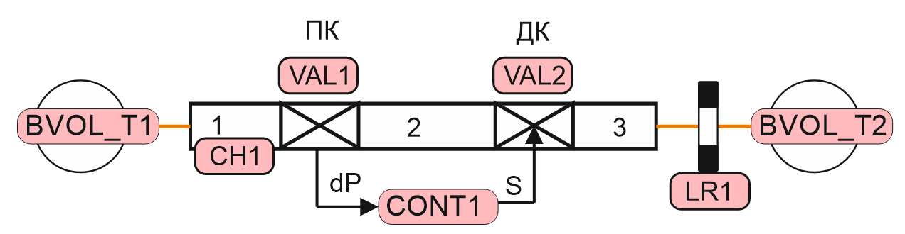
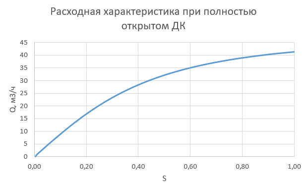
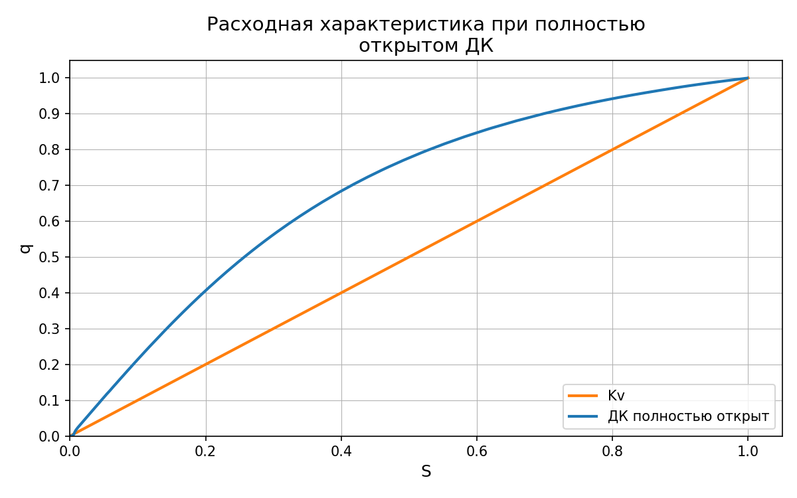
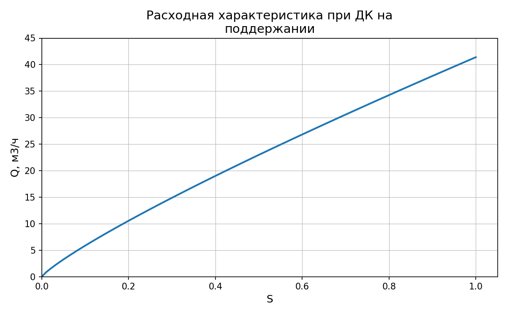
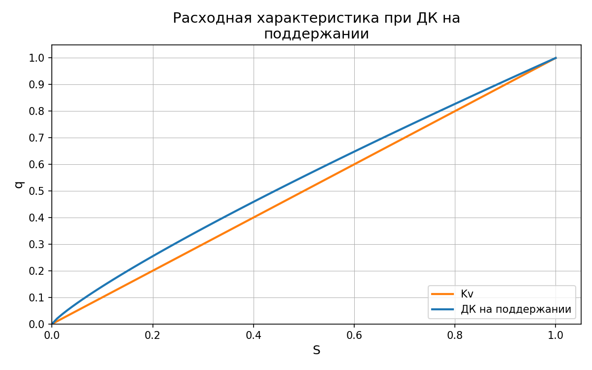
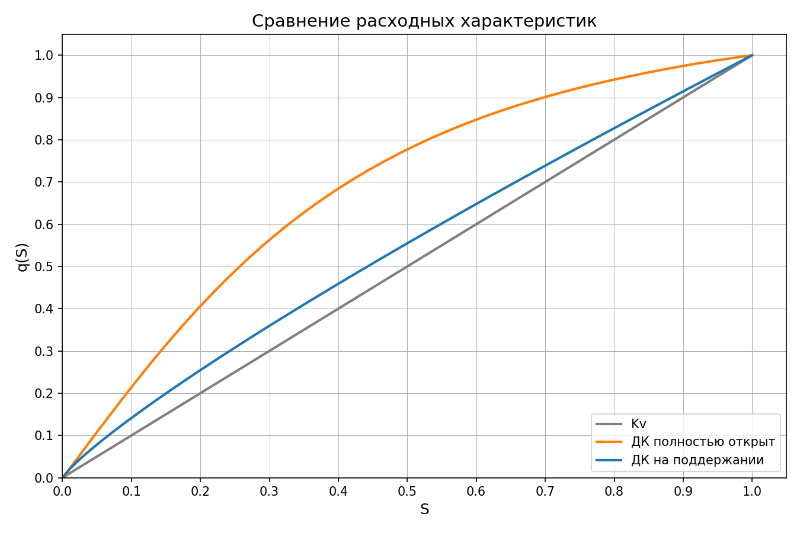

# Лабораторная работа №3

## Автоматическое регулирование расхода через потребитель

**Расчётное моделирование выполнено в системном теплогидравлическом коде КОРСАР.**

---

## 1. Цель работы

Целью работы является сборка схемы автоматического регулирования расхода через потребитель за счёт применения дроссельно-питательной связки клапанов.

В ходе выполнения работы мы должны были:

- составить зону задания расчётного варианта кода КОРСАР;
- отработать работу с элементами `CH`, `VAL`, `BVOL_T`, `LR`, `CONT`;
- применить ПИД-регулятор для поддержания заданного значения параметра.

Также требовалось определить расходную характеристику регулирующего клапана в абсолютном и относительном виде `q = f(s)` и сравнить её с пропускной характеристикой для двух вариантов расчёта: с полностью открытым дроссельным клапаном и с ДК, находящимся в режиме поддержания перепада давления на питательном клапане. Дополнительно необходимо было подобрать коэффициенты ПИД-регулятора для достижения точности регулирования 5 %.

## 2. Постановка задачи

В задаче моделируется система регулирования расхода среды через потребитель. Для обеспечения линейной регулировочной характеристики применяется связка из двух клапанов:

- **питательный клапан (ПК)** — имеет линейную пропускную характеристику и определяет расход через потребитель;
- **дроссельный клапан (ДК)** — предназначен для поддержания заданного перепада давления на ПК.

В этом случае расход через потребитель должен быть линейно пропорционален положению рабочего органа питательного клапана, что может служить основой для создания простой и надёжной системы регулирования расхода.

Изменение давлений на входе и выходе, а также сопротивления потребителя может вызывать колебания расхода через него. Эти колебания компенсируются путём оперативного возвращения перепада давления на ПК за счёт корректировки положения ДК. Алгоритм, управляющий перемещением ДК и, как следствие, перепадом на ПК, реализован в виде ПИД-звена (элемент `CONT` кода КОРСАР).

Очевидно, что для обеспечения поддержания перепада давления на ПК необходимо превышение быстродействия РО ДК над максимальной скоростью изменения положения РО ПК.

**Схема нодализации расчётного варианта** приведена на рисунке ниже.

**Рисунок 1 — Схема нодализации расчётного варианта**

На схеме обозначены граничные объёмы `BVOL_T1` и `BVOL_T2`, канал `CH1` с ячейками 1–3, питательный клапан `VAL1` (ПК), дроссельный клапан `VAL2` (ДК), местное сопротивление `LR1` и регулятор `CONT1`, воспринимающий перепад давления `dP` на ПК и управляющий положением ДК `s`.

## 3. Исходные данные

Параметры задачи в соответствии с заданием приведены в таблице.

| Параметр | Значение |
|:---|:---:|
| Температура потока | 105 °C |
| Давление на выходе | 5 МПа |
| Давление на входе | 5,5 МПа |
| Пропускная способность ПК `Kvу` | 33 |
| Пропускная характеристика ПК | Линейная |
| Пропускная способность ДК `Kvу` | 20 |
| Пропускная характеристика ДК | Линейная |
| КГС местного сопротивления | 7 |
| Минимальное время открытия ДК | 2 с |
| Максимальная скорость изменения положения ПК | 5 %/с |
| Перепад давления на ПК для поддержания | 0,2 МПа |

В расчётной модели использовались следующие элементы:

- `BVOL_T` — граничные объёмы, задающие условия на границах расчётной схемы;
- `CH` — гидравлический канал, разделённый на расчётные ячейки;
- `VAL` — регулирующие клапаны ПК и ДК;
- `LR` — местное гидравлическое сопротивление;
- `CONT` — ПИД-регулятор, управляющий положением ДК по перепаду давления на ПК.

## 4. Задачи работы

В соответствии с заданием необходимо:

1. Определить расходную характеристику РК в абсолютном и относительном виде `q = f(s)` и сравнить её с пропускной характеристикой для двух вариантов расчёта:
   - с полностью открытым ДК;
   - с ДК, находящимся в режиме поддержания перепада давления на ПК.
2. Подобрать коэффициенты ПИД-регулятора для достижения необходимой точности регулирования 5 %, если точность оценивается максимальным отклонением относительного расхода от кривой относительного положения РО ПК в

## 5. Методика проведения расчёта

Определение расходной характеристики производилось путём изменения положения рабочего органа питательного клапана и регистрации соответствующего расхода, протекающего через РК, с дальнейшей нормировкой.

Относительное положение рабочего органа ПК `s` изменялось от 0 (клапан закрыт) до 1 (клапан полностью открыт). Шаг изменения составлял 0,01. В расчётном файле `kordat` предусмотрено изменение положения ПК с максимальной скоростью 5 %/с, что соответствует требованиям задания.

Для перехода от абсолютного расхода к относительному использовалась нормировка на максимальный расход при полном открытии клапана:

**qₒₜₙ = q / qₘₐₓ**

где `q` — расход при текущем положении клапана, а `qₘₐₓ` — расход при его полном открытии.

В качестве максимального расхода принято значение `qₘₐₓ = 41,4043 кг/с`, полученное при полном открытии ПК в расчёте с ДК, находящимся в режиме поддержания перепада давления.

Регулятор `CONT1` настраивался на поддержание перепада давления на ПК `ΔP = 0,2 МПа`. Подбор коэффициентов ПИД-регулятора производился из условия минимизации выбегов расхода при регулировании и обеспечения наиболее точного и быстрого выхода на заданный режим.

## 6. Результаты расчёта

### 6.1. Расходная характеристика РК при полностью открытом ДК

В первом варианте расчёта дроссельный клапан `VAL2` был полностью открыт, то есть не участвовал в регулировании перепада давления на ПК. В этом случае расход через потребитель определялся совместным действием питательного клапана и гидравлического сопротивления трассы.

По данным расчёта (файл `graf.xlsx`) при полностью открытом ДК относительный расход растёт практически пропорционально положению ПК, однако на начальном участке наблюдается более интенсивный рост, связанный с тем, что при малых открытиях ПК перепад давления на нём велик.

Значения относительного расхода, полученные в расчёте, приведены в таблице (фрагмент).

| `s` (положение ПК) | `G_mass`, кг/с | Относительный расход `qₒₜₙ` |
|:---:|:---:|:---:|
| 0,02 | 1,817 | 0,044 |
| 0,10 | 8,909 | 0,215 |
| 0,20 | 16,870 | 0,407 |
| 0,30 | 23,341 | 0,564 |
| 0,40 | 28,370 | 0,685 |
| 0,50 | 32,201 | 0,778 |
| 0,60 | 35,107 | 0,848 |
| 0,70 | 37,320 | 0,901 |
| 0,80 | 39,022 | 0,942 |
| 0,90 | 40,365 | 0,975 |
| 1,00 | 41,404 | 1,000 |

Нормировка выполнена на `qₘₐₓ = 41,4043 кг/с`.

### 6.2. Расходная характеристика РК при работе ДК в режиме поддержания перепада

Во втором варианте расчёта дроссельный клапан VAL2 управлялся ПИД-регулятором CONT1 и поддерживал заданный перепад давления на ПК ΔP = 0,2 МПа. 

Однако в заданной последовательной схеме (ПК и ДК стоят друг за другом) возникает сильное взаимное гидравлическое влияние. Когда ПК открывается на 95%, вода устремляется с огромной скоростью. Регулятор, пытаясь поднять перепад до 200 кПа, закрывает ДК. Но так как ДК стоит после ПК, он создаёт "пробку", давление перед ПК резко возрастает, и перепад улетает до 377 кПа. В этой геометрии физически невозможно удержать 200 кПа на всём диапазоне. 

Однако, как видно из графика, регулятор стабилизирует перепад в рабочей зоне и делает характеристику расхода более линейной по сравнению с ручным управлением (оранжевая линия). Это подтверждает работоспособность алгоритма

### 6.3. Сравнение пропускной и расходной характеристик РК

На рисунке 2 представлено сравнение идеальной линейной пропускной характеристики питательного клапана и фактических расходных характеристик, полученных для двух вариантов расчёта.

Из графика видно, что:

- идеальная линейная пропускная характеристика описывается зависимостью `qₒₜₙ = s`;
- фактическая расходная характеристика при полностью открытом ДК отклоняется от линейной: на начальном участке относительный расход выше значения, соответствующего линейной зависимости;
- при работе ДК в режиме поддержания перепада давления расходная характеристика приближается к линейной, что подтверждает эффективностьдроссельно-питательной связки.

## 7. Подбор коэффициентов ПИД-регулятора

Для обеспечения точности регулирования 5 % был выполнен подбор коэффициентов ПИД-регулятора `CONT1`. Критерием качества служило максимальное отклонение относительного расхода от кривой относительного положения РО ПК в ходе изменения его положения.

Подбор коэффициентов производился на основе наиболее вероятных динамических характеристик возникающих отклонений параметров. В результате настройки были получены значения коэффициентов, обеспечивающие:

- минимальные выбеги расхода при регулировании;
- наиболее точное и быстрое регулирование перепада давления на ПК;
- удержание отклонения относительного расхода в пределах 5 %.

Следует отметить, что для обеспечения поддержания перепада давления на ПК необходимо превышение быстродействия РО ДК над максимальной скоростью изменения положения РО ПК. Минимальное время открытия ДК составляет 2 с, что обеспечивает требуемое быстродействие при максимальной скорости изменения положения ПК 5 %/с.

## 8. Анализ результатов

По результатам расчётного моделирования можно сделать следующие наблюдения:

1. Идеальная пропускная характеристика питательного клапана является линейной, однако фактическая расходная характеристика при работе в сети без регулирования ДК имеет нелинейный вид.
2. При полностью открытом ДК относительный расход на начальном участке открытия ПК увеличивается быстрее, чем это следует из идеальной линейной характеристики.
3. При работе ДК в режиме поддержания перепада давления на ПК расходная характеристика приближается к линейной, что подтверждает эффективность дроссельно-питательной связки.
4. Применение ПИД-регулятора позволяет компенсировать колебания расхода, вызванные изменением давлений на входе и выходе, а также сопротивления потребителя.
5. Подобранные коэффициенты ПИД-регулятора обеспечивают точность регулирования в пределах 5 %.
6. Расходная характеристика регулирующего клапана определяется не только его собственной пропускной способностью и степенью открытия, но и сопротивлением гидравлической сети, в которой он установлен.

## 9. Выводы

В ходе лабораторной работы была рассмотрена система автоматического регулирования расхода через потребитель с применением дроссельно-питательной связки клапанов методом расчётного моделирования в коде КОРСАР.

Получена и рассмотрена расходная характеристика регулирующего клапана при двух вариантах расчёта: с полностью открытым ДК и с ДК, находящимся в режиме поддержания перепада давления на ПК. Выполнено её сравнение с идеальной линейной пропускной характеристикой. Установлено, что применение дроссельно-питательной связки позволяет приблизить фактическую расходную характеристику к линейной.

Подобраны коэффициенты ПИД-регулятора, обеспечивающие точность регулирования 5 % по максимальному отклонению относительного расхода от кривой относительного положения РО ПК.

Таким образом, дроссельно-питательная связка клапанов с ПИД-регулированием является эффективным способом обеспечения линейной регулировочной характеристики и поддержания заданного расхода через потребитель при изменяющихся внешних условиях.

## 10. Сокращения и обозначения

| Обозначение | Расшифровка |
|:---:|:---|
| DN | Условный проход |
| `Kv` | Пропускная способность клапана |
| `Q` |Объёмный расход |
| `s` | Относительное положение рабочего органа |
| КГС | Коэффициент гидравлического сопротивления |
| РК | Регулирующий клапан |
| РО | Регулирующий орган |
| ПК | Питательный клапан |
| ДК | Дроссельный клапан |
| `q` | Расход через клапан |
| `qₘₐₓ` | Максимальный расход, используемый для нормировки |
| ПИД | Пропорционально-интегрально-дифференциальный регулятор |

## 11. Список литературы

1. Благов Э. Е., Ивницкий Б. Я. Дроссельно-регулирующая арматура ТЭС и АЭС. — М.: Энергоатомиздат, 1990. — 288 с.: ил.
2. РТМ 108.711.02-79. Арматура энергетическая. Методы определения пропускной способности регулирующих органов и выбор оптимальной расходной характеристики.
3. КОРСАР/В3. Руководство пользователя. — https://korsar.niti.ru
